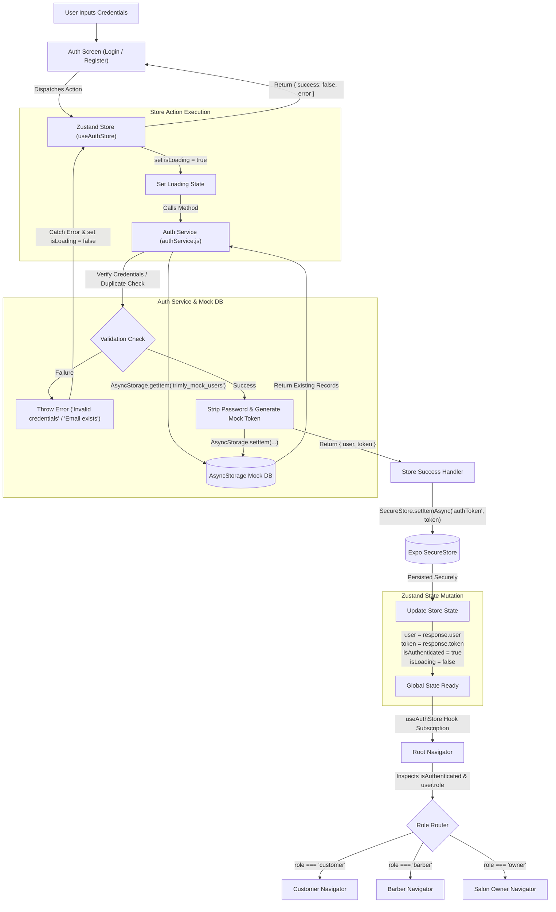

# Trimly Authentication Architecture & Technical Documentation

> **Document Version:** 1.0.0  
> **Target System:** Trimly Mobile Application (React Native / Expo)  
> **Document Role:** Senior React Native Developer & Technical Documentation Engineer  
> **Status:** Mock Authentication Implementation (Phase 1)

---

## Table of Contents
1. [A. Project Overview](#a-project-overview)
2. [B. Technology Stack](#b-technology-stack)
3. [C. Folder Structure](#c-folder-structure)
4. [D. Authentication Architecture](#d-authentication-architecture)
5. [E. Authentication Data Flow](#e-authentication-data-flow)
6. [F. File-by-File Explanation](#f-file-by-file-explanation)
   - [1. src/constants/config.js](#1-srcconstantsconfigjs)
   - [2. src/services/api.js](#2-srcservicesapijs)
   - [3. src/services/authService.js](#3-srcservicesauthservicejs)
   - [4. src/services/useAuthStore.js](#4-srcservicesuseauthstorejs)
7. [G. Registration Process](#g-registration-process)
8. [H. Login Process](#h-login-process)
9. [I. Session Persistence & Token Storage](#i-session-persistence--token-storage)
10. [J. Logout Process](#j-logout-process)
11. [K. Current Implementation Status](#k-current-implementation-status)
12. [L. Current Limitations](#l-current-limitations)
13. [M. Future Backend Integration Guide](#m-future-backend-integration-guide)
14. [N. Development Roadmap](#n-development-roadmap)

---

## A. Project Overview

### What is Trimly?
**Trimly** is an on-demand hair salon and grooming platform built with **React Native (Expo)**. The mobile ecosystem seamlessly connects hair salons, professional barbers/stylists, and clients within a single unified application. 

### User Roles in Trimly
Trimly operates across three distinct user roles, each having unique permissions, interfaces, and operational workflows:

```
                  +-----------------------------------+
                  |         Trimly Mobile App         |
                  +-----------------+-----------------+
                                    |
          +-------------------------+-------------------------+
          |                         |                         |
          v                         v                         v
+-------------------+     +-------------------+     +-------------------+
|     Customer      |     |      Barber       |     |    Salon Owner    |
+-------------------+     +-------------------+     +-------------------+
| - Discover salons |     | - Schedule view   |     | - Salon profile   |
| - Book services   |     | - Manage bookings |     | - Manage barbers  |
| - Select barbers  |     | - Client tracking |     | - Analytics & rev |
| - Review history  |     | - Earnings status |     | - Working hours   |
+-------------------+     +-------------------+     +-------------------+
```

1. **Customer**:
   - Searches and discovers local hair salons and independent barbers.
   - Books appointments, selects specific services (e.g., haircut, beard trim, color), and chooses preferred time slots.
   - Tracks appointment statuses and maintains appointment history.
2. **Barber**:
   - Manages personal daily and weekly service schedules.
   - Views incoming client bookings, marks appointments as completed or cancelled.
   - Tracks individual tips, commissions, and daily earnings.
3. **Salon Owner**:
   - Configures salon profiles, operational working hours, chairs, and services offered.
   - Adds, assigns, and oversees barbers and staff working within the salon.
   - Accesses high-level business analytics, foot traffic, and revenue metrics.

### Purpose of the Authentication Module
The authentication module serves as the primary security gatekeeper and router for Trimly:
- **Identity Verification**: Authenticates users during registration and login.
- **Role-Based Access Control (RBAC)**: Identifies whether the logged-in entity is a Customer, Barber, or Salon Owner, enabling downstream navigators to present the appropriate UI experience.
- **Secure Token Management**: Safely persists session credentials across application restarts using hardware-backed secure storage.
- **Service Decoupling**: Encapsulates authentication mechanics inside an isolated service and global store, allowing frictionless migration from the current local mock implementation to a production cloud backend.

---

## B. Technology Stack

The Trimly authentication system leverages a lightweight, production-ready mobile stack. Below is an overview of the core technologies and their specific responsibilities based on `package.json`:

| Technology | Version | Purpose in Trimly |
| :--- | :--- | :--- |
| **Expo SDK** | `^58.0.22` | Core cross-platform application framework and toolchain providing native APIs, standard runtime configurations, and module management for iOS and Android. |
| **React Native** | Core runtime | Cross-platform mobile UI library utilizing native components. |
| **JavaScript (ES6+ / JSX)** | Modern ECMAScript | Project programming language utilizing async/await, closures, object destructuring, and JSX component syntax. |
| **Zustand** | `^5.0.16` | Global client state management library. Controls reactive authentication state (`user`, `token`, `isAuthenticated`, `isLoading`, `isInitializing`) with minimal boilerplate. |
| **Axios** | `^1.21.0` | Promise-based HTTP client. Configured as a centralized singleton (`api.js`) for base URL, timeouts, and request/response interceptors when real REST endpoints become available. |
| **Expo SecureStore** | `~58.0.2` | Hardware-backed encrypted key-value storage (iOS Keychain and Android Keystore). Exclusively used to persist the sensitive session token (`authToken`). |
| **AsyncStorage** | `2.2.0` (`@react-native-async-storage/async-storage`) | Unencrypted, persistent, asynchronous key-value storage on disk. In the current Phase 1 implementation, it acts as a simulated local database storing the mock registered user records (`trimly_mock_users`). |
| **React Navigation** | `^7.5.1` (Native)<br>`^7.21.0` (Stack & Tabs) | Declarative navigation library. Installed to manage role-based routing (Auth Stack, Customer Tabs, Barber Tabs, Owner Tabs) conditioned on authentication state. *(Pending UI implementation)*. |
| **Yup** | `^1.7.1` | Object schema validation library. Installed to validate registration and login form schemas (email structure, password complexity, role selection). *(Pending UI implementation)*. |

---

## C. Folder Structure

The project has been scaffolded to support a modular, role-based architecture. Below is the current directory tree of the workspace, followed by explanations of each directory and authentication file.

```
trimly-frontend/
├── app.json
├── package.json
├── package-lock.json
├── AUTHENTICATION_DOCUMENTATION.md
└── src/
    ├── assets/
    │   ├── fonts/
    │   └── images/
    ├── components/
    │   ├── barber/
    │   ├── core/
    │   ├── customer/
    │   ├── layout/
    │   └── owner/
    ├── constants/
    │   └── config.js
    ├── navigation/
    ├── screens/
    │   ├── Auth/
    │   │   └── SetupWizard/
    │   ├── Barber/
    │   ├── Customer/
    │   └── Owner/
    ├── services/
    │   ├── api.js
    │   ├── authService.js
    │   └── useAuthStore.js
    ├── store/
    └── utils/
```

### Folder Responsibilities

- **`src/`**: Root container for all application logic, screens, assets, and state.
- **`src/assets/`**: Static design assets including brand fonts (`fonts/`) and iconography/graphics (`images/`).
- **`src/components/`**: Reusable atomic and composite UI elements:
  - `core/`: Generic primitives (buttons, inputs, loaders, typography).
  - `layout/`: Containers, headers, safe-area wrappers.
  - `customer/`, `barber/`, `owner/`: Role-specific view components.
- **`src/constants/`**: Immutable configuration variables and environment constants (`config.js`).
- **`src/navigation/`**: Stack and tab navigators managing screen transitions and conditional routing based on role and auth status.
- **`src/screens/`**: High-level page components organized by domain:
  - `Auth/`: Login, register, forgot password, and `SetupWizard/` for onboarding.
  - `Customer/`: Client appointment booking, search, and profile views.
  - `Barber/`: Stylist appointments, chair schedule, and earnings views.
  - `Owner/`: Salon management, staff roster, and analytics views.
- **`src/services/`**: Communication layer handling API instances (`api.js`), mock business logic (`authService.js`), and global state (`useAuthStore.js`).
- **`src/store/`**: Dedicated directory scaffolded for Zustand stores *(Note: see architectural inconsistency note below)*.
- **`src/utils/`**: Helper utilities including string formatters, date handlers, and validation helpers.

> [!WARNING]
> **Architectural Inconsistency Discovered:**  
> The Zustand authentication store is currently located at `src/services/useAuthStore.js`, while `src/store/` exists as an empty directory. Best practices dictate that state stores reside in `src/store/` to separate state from backend communication services.

---

## D. Authentication Architecture

The Trimly authentication system adheres to the **Separation of Concerns (SoC)** principle. Each layer has an isolated, well-defined responsibility.

```
+-------------------------------------------------------------+
|                      1. UI Screens                          |
|        (LoginScreen, RegisterScreen, SetupWizard)           |
+------------------------------+------------------------------+
                               | Dispatches Actions / Reads State
                               v
+-------------------------------------------------------------+
|                     2. Zustand Store                        |
|                  (`useAuthStore.js`)                        |
|        - Manages global state (user, token, flags)          |
|        - Orchestrates async flows                           |
+---------------+-----------------------------+---------------+
                | Calls Business Methods      | Persists Session Token
                v                             v
+-------------------------------+   +-------------------------+
|     3. Auth Service           |   |   5. Secure Storage     |
|   (`authService.js`)          |   |   (Expo SecureStore)    |
| - Validates credentials       |   | - Holds 'authToken'     |
| - Generates mock JWT          |   | - iOS Keychain          |
| - Interacts with mock storage |   | - Android Keystore      |
+---------------+---------------+   +-------------------------+
                |
                | Reads/Writes Mock User Records
                v
+-------------------------------+   +-------------------------+
|     4. Mock DB Storage        |   |   6. API Client         |
|        (AsyncStorage)         |   |      (`api.js`)         |
| - Holds 'trimly_mock_users'   |   | - Axios Singleton       |
+-------------------------------+   | - Ready for Real APIs   |
                                    +-------------------------+
```

### Separation of Responsibilities

1. **UI Screens (`src/screens/Auth/`)**:
   - Collect user input (email, password, role, name).
   - Trigger client-side schema validation (Yup).
   - Call store methods (`login`, `register`, `logout`).
   - Purely presentational; contains zero direct storage or network calls.

2. **Zustand Store (`src/services/useAuthStore.js`)**:
   - Holds global application authentication state (`user`, `token`, `isAuthenticated`, `isLoading`, `isInitializing`).
   - Provides asynchronous action handlers to UI screens.
   - Coordinates session tokens with `Expo SecureStore`.
   - Protects UI from service implementation details.

3. **Authentication Service (`src/services/authService.js`)**:
   - Encapsulates domain business logic for authentication.
   - Checks duplicate emails, validates passwords, and formats user data.
   - Decoupled from state management; pure async functions returning standard JavaScript objects or throwing errors.

4. **API Configuration (`src/constants/config.js` & `src/services/api.js`)**:
   - Holds network constants (base URL, timeouts, headers).
   - Instantiates the shared Axios HTTP client.
   - Ready to receive auth tokens and request/response interceptors.

5. **Secure Token Storage (`Expo SecureStore`)**:
   - Stores only the session token (`authToken`) inside native hardware-backed storage.
   - Protects session tokens from device-level extraction.

6. **Navigation Layer (`src/navigation/`)**:
   - Listens to `isAuthenticated` and `user.role` from `useAuthStore`.
   - Conditionally mounts the Auth Stack or the corresponding Role Stack (Customer, Barber, Owner).

### Why Are These Separated?
- **Maintainability**: Swapping mock storage for real HTTP API endpoints only requires updating `authService.js`. The UI screens and Zustand store remain completely untouched.
- **Testability**: Services and stores can be unit tested without mounting React UI components.
- **Security**: Sensitive credentials and session tokens are strictly routed through hardware-encrypted channels rather than general application state or unencrypted storage.

---

## E. Authentication Data Flow

### Registration Flow
1. **User Action**: The user fills out their full name, email, password, and selects their role (Customer, Barber, Salon Owner), then taps "Register".
2. **UI Dispatch**: The UI screen validates inputs using Yup and calls `useAuthStore.getState().register(userData)`.
3. **Store State**: The store sets `isLoading: true` to trigger loading indicators in the UI.
4. **Service Execution**: The store calls `authService.register(userData)`.
5. **Duplicate Verification**: `authService` retrieves existing mock users from `AsyncStorage` and verifies no duplicate email exists.
6. **Persistence**: `authService` generates a user ID via `Date.now().toString()`, appends the new record to `AsyncStorage` under `trimly_mock_users`, and creates a mock token `mock-jwt-<id>`.
7. **Secure Storage**: Upon receiving the response, `useAuthStore` saves the mock token into `Expo SecureStore` under the key `'authToken'`.
8. **State Mutation**: `useAuthStore` updates `user`, `token`, and sets `isAuthenticated: true` and `isLoading: false`.
9. **Navigation Transition**: The Root Navigator detects `isAuthenticated: true` and mounts the corresponding role-based home screen.

### Login Flow
1. **User Action**: The user inputs their email and password, then taps "Sign In".
2. **UI Dispatch**: The UI screen dispatches `useAuthStore.getState().login(email, password)`.
3. **Store State**: The store sets `isLoading: true`.
4. **Credential Verification**: `authService.login(email, password)` fetches users from `AsyncStorage` and checks for a matching email and password.
5. **Security Sanitization**: If credentials match, `authService` strips out the plain password and returns safe user data with a generated mock token. If not, it throws an error (`"Invalid email or password."`).
6. **Token Persistence**: The store captures the token and writes it to `Expo SecureStore`.
7. **State Mutation**: The store updates `user`, `token`, `isAuthenticated: true`, and resets `isLoading: false`.
8. **Navigation Transition**: The Root Navigator renders the appropriate dashboard according to `user.role`.

### Complete Authentication Mermaid Diagram



---

## F. File-by-File Explanation

### 1. `src/constants/config.js`

#### Purpose
Centralizes global configuration constants and network parameters used across all network and service layers.

#### Implementation Code
```javascript
export const API_CONFIG = {
  BASE_URL: 'https://your-mock-api-url.com',
  TIMEOUT: 10000,
};
```

#### Detailed Breakdown
- **Exported Constants**:
  - `API_CONFIG.BASE_URL`: Holds the host URL for future HTTP endpoints. Currently set to a placeholder (`https://your-mock-api-url.com`).
  - `API_CONFIG.TIMEOUT`: Request timeout in milliseconds (`10000`ms = 10 seconds), preventing hanging requests on slow mobile networks.
- **Data Flow**: Exported and consumed directly by `src/services/api.js`.

---

### 2. `src/services/api.js`

#### Purpose
Configures and exports a shared, pre-configured **Axios** HTTP client instance.

#### Implementation Code
```javascript
import axios from 'axios';
import { API_CONFIG } from '../constants/config';

const api = axios.create({
  baseURL: API_CONFIG.BASE_URL,
  timeout: API_CONFIG.TIMEOUT,
  headers: {
    'Content-Type': 'application/json',
  },
});

export default api;
```

#### Detailed Breakdown
- **Important Configuration**:
  - `baseURL`: Automatically prepended to all relative request URLs.
  - `timeout`: Enforces the 10-second timeout from `API_CONFIG`.
  - `headers`: Sets standard `Content-Type: application/json` for REST communication.
- **Communication**: Ready to be imported by service files to perform real HTTP requests (`api.get()`, `api.post()`). In the current Phase 1 implementation, it is scaffolded but not yet utilized by `authService.js`.

---

### 3. `src/services/authService.js`

#### Purpose
Contains the core authentication business logic and acts as an in-app simulated backend by reading and writing user accounts to `AsyncStorage`.

#### Implementation Code
```javascript
import AsyncStorage from '@react-native-async-storage/async-storage';

const USERS_KEY = 'trimly_mock_users';

const authService = {
  getUsers: async () => {
    const data = await AsyncStorage.getItem(USERS_KEY);
    return data ? JSON.parse(data) : [];
  },

  register: async (userData) => {
    const users = await authService.getUsers();

    const existingUser = users.find(
      (user) => user.email === userData.email.toLowerCase()
    );

    if (existingUser) {
      throw new Error('Email is already registered.');
    }

    const newUser = {
      id: Date.now().toString(),
      name: userData.name,
      email: userData.email.toLowerCase(),
      role: userData.role,
      password: userData.password,
    };

    await AsyncStorage.setItem(
      USERS_KEY,
      JSON.stringify([...users, newUser])
    );

    return {
      user: {
        id: newUser.id,
        name: newUser.name,
        email: newUser.email,
        role: newUser.role,
      },
      token: `mock-jwt-${newUser.id}`,
    };
  },

  login: async (email, password) => {
    const users = await authService.getUsers();

    const user = users.find(
      (item) =>
        item.email === email.toLowerCase() &&
        item.password === password
    );

    if (!user) {
      throw new Error('Invalid email or password.');
    }

    const { password: _, ...safeUser } = user;

    return {
      user: safeUser,
      token: `mock-jwt-${user.id}`,
    };
  },

  getCurrentUser: async (token) => {
    const users = await authService.getUsers();

    const userId = token.replace('mock-jwt-', '');

    const user = users.find((item) => item.id === userId);

    if (!user || token !== `mock-jwt-${user.id}`) {
      throw new Error('Invalid session.');
    }

    const { password: _, ...safeUser } = user;

    return safeUser;
  },
};

export default authService;
```

#### Functions Breakdown
- **`getUsers()`**:
  - *Data In*: None.
  - *Data Out*: Returns an array of user objects parsed from `AsyncStorage`. Defaults to `[]` if storage is empty.
- **`register(userData)`**:
  - *Data In*: `userData` object containing `name`, `email`, `role`, and `password`.
  - *Data Out*: Resolves to `{ user: { id, name, email, role }, token: 'mock-jwt-<id>' }` or throws `'Email is already registered.'`.
  - *Logic*: Enforces lowercase email normalization, checks for existing users, creates a timestamp-based ID, saves the array to `AsyncStorage`, and returns a safe sanitized user object.
- **`login(email, password)`**:
  - *Data In*: Raw `email` (string) and `password` (string).
  - *Data Out*: Resolves to `{ user: safeUser, token: 'mock-jwt-<id>' }` or throws `'Invalid email or password.'`.
  - *Logic*: Compares lowercase email and plain text password. Destructures out `password` so it is never exposed in the return payload.
- **`getCurrentUser(token)`**:
  - *Data In*: Session `token` string (e.g. `'mock-jwt-1711928374'`).
  - *Data Out*: Resolves to sanitized `safeUser` object or throws `'Invalid session.'`.
  - *Logic*: Parses `userId` from the token prefix, locates the matching user, and confirms token validity.

---

### 4. `src/services/useAuthStore.js`

#### Purpose
Global client state manager created with Zustand. Holds the reactive authentication state and orchestrates calls between `authService` and `Expo SecureStore`.

#### Implementation Code
```javascript
import { create } from 'zustand';
import * as SecureStore from 'expo-secure-store';
import authService from '../services/authService';

const useAuthStore = create((set) => ({
  user: null,
  token: null,
  isAuthenticated: false,
  isLoading: false,
  isInitializing: true,

  login: async (email, password) => {
    try {
      set({ isLoading: true });

      const response = await authService.login(email, password);

      await SecureStore.setItemAsync('authToken', response.token);

      set({
        user: response.user,
        token: response.token,
        isAuthenticated: true,
      });

      return { success: true };
    } catch (error) {
      return { success: false, error: error.message };
    } finally {
      set({ isLoading: false });
    }
  },

  register: async (userData) => {
    try {
      set({ isLoading: true });

      const response = await authService.register(userData);

      await SecureStore.setItemAsync('authToken', response.token);

      set({
        user: response.user,
        token: response.token,
        isAuthenticated: true,
      });

      return { success: true };
    } catch (error) {
      return { success: false, error: error.message };
    } finally {
      set({ isLoading: false });
    }
  },

  restoreSession: async () => {
    try {
      const token = await SecureStore.getItemAsync('authToken');

      if (!token) return;

      const user = await authService.getCurrentUser(token);

      set({
        token,
        user,
        isAuthenticated: true,
      });
    } catch (error) {
      console.log('Session restoration failed:', error);

      await SecureStore.deleteItemAsync('authToken');
    } finally {
      set({ isInitializing: false });
    }
  },

  logout: async () => {
    try {
      await SecureStore.deleteItemAsync('authToken');
    } finally {
      set({
        user: null,
        token: null,
        isAuthenticated: false,
        isLoading: false,
      });
    }
  },
}));

export default useAuthStore;
```

#### State Variables
- `user` (*object | null*): Current logged-in user profile (`{ id, name, email, role }`).
- `token` (*string | null*): Active authentication token (`mock-jwt-<id>`).
- `isAuthenticated` (*boolean*): Quick boolean flag indicating whether a valid session is active.
- `isLoading` (*boolean*): Indicates whether an active login or register async operation is executing.
- `isInitializing` (*boolean*): Indicates whether the app is currently reading `SecureStore` to restore a previous session during app startup.

#### Actions Breakdown
- **`login(email, password)`**: Executes login sequence, securely caches token, updates state, and returns `{ success: true }` or `{ success: false, error }`.
- **`register(userData)`**: Executes registration sequence, caches token, updates state, and returns `{ success: true }` or `{ success: false, error }`.
- **`restoreSession()`**: Reads `'authToken'` from hardware storage upon app startup. If found, hydrates user data; if expired/invalid, deletes the corrupted token. Always marks `isInitializing: false`.
- **`logout()`**: Removes `'authToken'` from `SecureStore` and resets `user`, `token`, and `isAuthenticated` to their initial values.

---

## G. Registration Process

Registration creates a new user within the simulated ecosystem:

```
[UI Form Data]
  { name: "John Doe", email: "JOHN@EXAMPLE.COM", role: "customer", password: "secret" }
       |
       v
[Email Normalization] -> email.toLowerCase() === "john@example.com"
       |
       v
[Duplicate Check] ----> Search AsyncStorage['trimly_mock_users']
       |
       +---> Match Found: Throw Error("Email is already registered.")
       |
       +---> No Match: Continue
               |
               v
       [Construct Record]
         id: Date.now().toString()
         name: "John Doe"
         email: "john@example.com"
         role: "customer"
         password: "secret"
               |
               v
       [AsyncStorage Update] -> Write back updated array
               |
               v
       [Token Generation] ----> `mock-jwt-${newUser.id}`
               |
               v
       [Sanitized Return]
         user: { id, name, email, role }  <-- (Password omitted)
         token: "mock-jwt-1711928374000"
```

1. **Input Collection**: The user provides `name`, `email`, `role`, and `password`.
2. **Email Normalization**: The email is transformed to lowercase to prevent duplicate registrations caused by letter casing differences.
3. **Duplicate Verification**: `authService.getUsers()` reads the JSON array from `AsyncStorage`. If `users.find()` matches the normalized email, execution halts with an error.
4. **User Creation**: A new record is assembled with an ID generated from `Date.now().toString()`.
5. **Persistence**: The updated user array is serialized via `JSON.stringify` and committed to `AsyncStorage` under `trimly_mock_users`.
6. **Mock Token Generation**: A mock JWT string is constructed using the pattern ``mock-jwt-${newUser.id}``.
7. **Sanitization**: The password field is excluded from the returned payload, keeping only `id`, `name`, `email`, and `role`.

---

## H. Login Process

The login process verifies existing credentials and hydrates the global application state:

```
[Login Screen] -> email, password
       |
       v
[Normalize Email] -> email.toLowerCase()
       |
       v
[Search AsyncStorage] -> users.find(u => u.email === normalized && u.password === password)
       |
       +---> No Match: Throw Error("Invalid email or password.")
       |
       +---> Match Found:
               |
               v
       [Sanitize Record]
         const { password: _, ...safeUser } = user;
               |
               v
       [Return Payload] -> { user: safeUser, token: `mock-jwt-${user.id}` }
               |
               v
       [useAuthStore.login]
         1. SecureStore.setItemAsync('authToken', token)
         2. set({ user: safeUser, token, isAuthenticated: true })
         3. return { success: true }
```

1. **Input Submission**: User passes email and password.
2. **Credential Matching**: `authService.login` scans `AsyncStorage` users for an exact match where `user.email === email.toLowerCase()` and `user.password === password`.
3. **Failure Handling**: If no matching record is found, an Error with message `'Invalid email or password.'` is thrown. The Zustand store catches this and returns `{ success: false, error: 'Invalid email or password.' }`, allowing the UI to display a user-friendly error toast or banner.
4. **Data Sanitization**: The password is stripped from the user object using object destructuring:
   ```javascript
   const { password: _, ...safeUser } = user;
   ```
5. **Token Storage**: The Zustand store takes the generated `response.token` and stores it into `Expo SecureStore` via `SecureStore.setItemAsync('authToken', response.token)`.
6. **State Reaction**: `isAuthenticated` flips to `true`, and `user` is populated, automatically triggering navigation to the appropriate dashboard.

---

## I. Session Persistence & Token Storage

### AsyncStorage vs. Expo SecureStore: Storage Division
A key architectural principle in Trimly is distinguishing between **unencrypted application data** and **sensitive cryptographic credentials**:

```
+-------------------------------------------------------------------------+
|                              Device Storage                             |
+------------------------------------+------------------------------------+
|       Expo SecureStore             |          AsyncStorage              |
+------------------------------------+------------------------------------+
| - Hardware-encrypted               | - Unencrypted plain filesystem     |
| - iOS Keychain / Android Keystore  | - Sandbox JSON / SQLite storage    |
| - Key: 'authToken'                 | - Key: 'trimly_mock_users'         |
| - Holds: Active Session Token      | - Holds: Mock Database Table       |
+------------------------------------+------------------------------------+
```

- **`AsyncStorage`**:
  - Unencrypted, key-value storage.
  - Used in Phase 1 strictly as the **local mock database** (`trimly_mock_users`) to store registered user profiles.
  - In a production environment with a real cloud backend, `AsyncStorage` will **not** store user credentials.
- **`Expo SecureStore`**:
  - Encrypted key-value storage backed by iOS Keychain Services and Android Keystore (AES-256 GCM).
  - Used exclusively to hold the session token (`authToken`).
  - Ensures that authentication tokens cannot be read even if an attacker gains access to unencrypted device backups.

### Session Restoration Lifecycle (`restoreSession`)
When a user launches or restarts Trimly, the app checks whether an existing valid session exists before displaying any screen:

```
              [App Launch / Initialization]
                           |
                           v
            useAuthStore.restoreSession()
                           |
                           v
        SecureStore.getItemAsync('authToken')
                           |
          +----------------+----------------+
          |                                 |
     Token Not Found                   Token Found
          |                                 |
          v                                 v
   (Do Nothing)              authService.getCurrentUser(token)
          |                                 |
          |                   +-------------+-------------+
          |                   |                           |
          |              User Valid                  User Invalid
          |                   |                           |
          |                   v                           v
          |            set({ user, token,        SecureStore.deleteItemAsync()
          |              isAuthenticated: true })         |
          |                   |                           |
          +-----------------> | <-------------------------+
                              v
                 set({ isInitializing: false })
                              |
                              v
                 [Render Root Navigation]
```

1. **Invocation**: The application root invokes `restoreSession()` on initial mount.
2. **Token Retrieval**: The store queries `SecureStore.getItemAsync('authToken')`.
   - If no token exists, the method terminates early and sets `isInitializing: false`. The user remains unauthenticated (`isAuthenticated: false`) and will see the Auth stack.
3. **Session Validation**: If a token is retrieved, the store calls `authService.getCurrentUser(token)`.
   - The service extracts the `userId` (`token.replace('mock-jwt-', '')`) and locates the user record in `AsyncStorage`.
   - If the user exists and the token matches, the sanitized user profile is returned.
4. **State Hydration**: The store updates `token`, `user`, and sets `isAuthenticated: true`.
5. **Corrupted / Expired Token Recovery**: If `getCurrentUser` throws an error (e.g. user was deleted from storage or token was tampered with), the `catch` block logs the failure and immediately deletes the invalid token via `SecureStore.deleteItemAsync('authToken')`.
6. **Initialization Flag**: Regardless of success or failure, the `finally` block sets `isInitializing: false`, dismissing any splash/loading screen and mounting the correct UI navigator.

---

## J. Logout Process

Logging out completely revokes local access and resets all global authentication variables:

```
[User Taps 'Log Out']
       |
       v
useAuthStore.getState().logout()
       |
       v
SecureStore.deleteItemAsync('authToken') ---> [Deletes token from Keychain / Keystore]
       |
       v
Reset Global Zustand State:
  user: null
  token: null
  isAuthenticated: false
  isLoading: false
       |
       v
[Root Navigator Re-evaluates] -> Reactively redirects user to Auth Stack (Login Screen)
```

### Logout Implementation Details
- **Token Invalidation**: `SecureStore.deleteItemAsync('authToken')` ensures that even if the app process is terminated immediately, no residual token remains in the secure hardware keychain.
- **State Reset**: The Zustand store resets `user: null`, `token: null`, `isAuthenticated: false`, and `isLoading: false`.
- **Reactive Navigation**: Because the root navigator subscribes to `useAuthStore((state) => state.isAuthenticated)`, the navigation tree re-renders automatically, unmounting all role dashboards and presenting the Login screen.

---

## K. Current Implementation Status

The table below provides an accurate, evidence-based assessment of the current codebase.

| Component / Feature | Current Status | Location in Codebase | Notes / Description |
| :--- | :---: | :--- | :--- |
| **API Configuration** | ✅ Implemented | `src/constants/config.js` | Exports `BASE_URL` and `TIMEOUT` (10s). |
| **Axios Instance** | ✅ Implemented | `src/services/api.js` | Configured with timeout and JSON headers; not yet used by `authService`. |
| **Mock Auth Service** | ✅ Implemented | `src/services/authService.js` | Implements `register`, `login`, `getUsers`, `getCurrentUser`. |
| **Local Mock Database** | ✅ Implemented | `src/services/authService.js` | Uses `AsyncStorage` with key `'trimly_mock_users'`. |
| **Global Auth Store** | ✅ Implemented | `src/services/useAuthStore.js` | Zustand store with `login`, `register`, `restoreSession`, `logout`. |
| **Secure Token Storage** | ✅ Implemented | `src/services/useAuthStore.js` | Uses `expo-secure-store` to manage `'authToken'`. |
| **Session Restoration** | ✅ Implemented | `src/services/useAuthStore.js` | Automatically restores session via `restoreSession()`. |
| **Store Directory Alignment** | ⚠️ Partial / Dislocated | `src/store/` (empty) | `useAuthStore.js` is currently located in `src/services/`. |
| **Form Validation Schemas** | ⏳ Not Implemented | `src/utils/` (empty) | `yup` is installed in `package.json`, but no schemas exist. |
| **Login UI Screen** | ⏳ Not Implemented | `src/screens/Auth/` (empty) | No React Native login UI component created yet. |
| **Registration UI Screen** | ⏳ Not Implemented | `src/screens/Auth/` (empty) | No registration form or role selector created yet. |
| **Auth Navigation Stack** | ⏳ Not Implemented | `src/navigation/` (empty) | React Navigation is installed, but no navigator files exist. |
| **Root Conditional Navigator** | ⏳ Not Implemented | `src/navigation/` (empty) | No routing based on `isAuthenticated` and `role`. |
| **Customer Role Screens** | ⏳ Not Implemented | `src/screens/Customer/` (empty) | Directory scaffolded; no screen files exist. |
| **Barber Role Screens** | ⏳ Not Implemented | `src/screens/Barber/` (empty) | Directory scaffolded; no screen files exist. |
| **Salon Owner Role Screens** | ⏳ Not Implemented | `src/screens/Owner/` (empty) | Directory scaffolded; no screen files exist. |
| **Application Entry Point** | ⏳ Not Implemented | Root / `App.js` | Neither `App.js` nor `index.js` exists in the repository. |
| **Real Backend Integration** | ⏳ Not Implemented | `src/services/api.js` | Real REST endpoints and token interceptors not connected. |

---

## L. Current Limitations

> [!IMPORTANT]
> The current authentication module is a **development-stage mock implementation**. It is designed to establish state contracts and UI flows before connecting to live services. It must not be deployed to production in its current state.

### Key Limitations:
1. **Mock Tokens are Not Real JWTs**:
   - The token generated is simply ``mock-jwt-${newUser.id}``.
   - It is not digitally signed using HMAC-SHA256 or RSA.
   - It cannot carry cryptographic claims or server-verifiable signatures.
2. **Insecure Plaintext Password Storage**:
   - Passwords are saved in plain text directly into `AsyncStorage` (`newUser.password = userData.password`).
   - `AsyncStorage` is unencrypted filesystem storage. Any device inspection or backup tool can read passwords in cleartext.
   - In production, passwords must never be stored on the client; they are hashed server-side (e.g. bcrypt/argon2).
3. **No Server-Side Authentication or Network Verification**:
   - All validation occurs strictly on the local device.
   - There is no central authority verifying accounts, email validity, or role permissions.
4. **No Token Expiration or Refresh Mechanism**:
   - Mock tokens never expire. Real production systems require short-lived access tokens (e.g. 15 minutes) and long-lived refresh tokens with rotation.
5. **Isolated Single-Device Mock Data**:
   - Accounts created on one device or emulator cannot be accessed on another.
   - Clearing application data, cache, or uninstalling the app permanently erases all registered mock accounts.
6. **No Network Latency or Offline Sync Handling**:
   - `AsyncStorage` operations resolve almost instantaneously. They do not simulate real-world mobile network challenges such as latency, DNS resolution failures, timeouts, or offline retry queues.

---

## M. Future Backend Integration Guide

When the backend engineering team provides live REST API endpoints, the current architecture can transition to production with zero disruption to the UI layer.

### Target Architectural Responsibilities

```
+---------------------------------------------------------------------------------+
|                               Production Setup                                  |
+---------------------------------------------------------------------------------+
| 1. Axios (api.js):                                                              |
|    - Set production BASE_URL.                                                   |
|    - Request Interceptor: Injects `Authorization: Bearer <token>` automatically.|
|    - Response Interceptor: Catches 401 Unauthorized to trigger token refresh.   |
|                                                                                 |
| 2. Auth Service (authService.js):                                               |
|    - Swaps `AsyncStorage` calls for `api.post('/auth/register', userData)`.     |
|    - Swaps mock login for `api.post('/auth/login', { email, password })`.      |
|    - Swaps getCurrentUser for `api.get('/auth/me')`.                            |
|                                                                                 |
| 3. Zustand Store (useAuthStore.js):                                             |
|    - Remains unchanged! Receives `{ user, token }` and updates state.           |
|                                                                                 |
| 4. Expo SecureStore:                                                            |
|    - Stores the genuine cryptographic JWT access token and refresh token.       |
+---------------------------------------------------------------------------------+
```

### Transition Steps for Backend Integration

#### 1. Update `src/constants/config.js`
Replace placeholder URLs with environment variables (e.g. via `expo-constants` or `.env` files):
```javascript
export const API_CONFIG = {
  BASE_URL: process.env.EXPO_PUBLIC_API_URL || 'https://api.trimly.com/v1',
  TIMEOUT: 15000,
};
```

#### 2. Configure Axios Interceptors in `src/services/api.js`
Attach request interceptors to automatically append the Bearer token stored in `SecureStore`:
```javascript
import axios from 'axios';
import * as SecureStore from 'expo-secure-store';
import { API_CONFIG } from '../constants/config';

const api = axios.create({
  baseURL: API_CONFIG.BASE_URL,
  timeout: API_CONFIG.TIMEOUT,
  headers: {
    'Content-Type': 'application/json',
  },
});

api.interceptors.request.use(async (config) => {
  const token = await SecureStore.getItemAsync('authToken');
  if (token) {
    config.headers.Authorization = `Bearer ${token}`;
  }
  return config;
});

export default api;
```

#### 3. Update `src/services/authService.js` to Use `api.js`
Replace local `AsyncStorage` operations with remote HTTP calls while maintaining identical function signatures:
```javascript
import api from './api';

const authService = {
  register: async (userData) => {
    // POST /auth/register
    const response = await api.post('/auth/register', userData);
    return response.data; // Expected: { user: {...}, token: "..." }
  },

  login: async (email, password) => {
    // POST /auth/login
    const response = await api.post('/auth/login', { email, password });
    return response.data; // Expected: { user: {...}, token: "..." }
  },

  getCurrentUser: async () => {
    // GET /auth/me (token automatically injected by Axios interceptor)
    const response = await api.get('/auth/me');
    return response.data; // Expected: { id, name, email, role, ... }
  },
};

export default authService;
```

#### 4. Zustand Store Compatibility
Because `authService` maintains identical return structures (`{ user, token }`), **`useAuthStore.js` requires zero changes to its business logic**.

---

## N. Development Roadmap

To complete the end-to-end authentication flow and deliver a working application, follow this 9-stage engineering roadmap:

```
[1. Login UI] ---> [2. Register UI] ---> [3. Form Validation (Yup)]
                                                   |
                                                   v
[6. Role Navigators] <-- [5. Root Nav] <-- [4. Auth Navigation]
        |
        v
[7. Profile Screens] --> [8. E2E Testing] --> [9. Real Backend API]
```

### Stage 1: Login UI Screen
- Create `src/screens/Auth/LoginScreen.js`.
- Implement user inputs for email and password, a toggle for password visibility, and a submission button with a loading spinner tied to `isLoading`.
- Add links to navigate to the Registration screen.

### Stage 2: Registration UI Screen
- Create `src/screens/Auth/RegisterScreen.js`.
- Build form fields for Full Name, Email, Password, and Confirm Password.
- Create a visual role selector component allowing the user to select between **Customer**, **Barber**, and **Salon Owner**.

### Stage 3: Form Validation with Yup
- Create validation schemas in `src/utils/validationSchemas.js` using `yup`:
  - Email format verification (`yup.string().email().required()`).
  - Password strength rules (minimum 6-8 characters).
  - Role selection requirement (`yup.string().oneOf(['customer', 'barber', 'owner'])`).
- Connect schemas with form state management (or React Hook Form) to display inline field errors.

### Stage 4: Authentication Navigation Stack
- Create `src/navigation/AuthNavigator.js` using `@react-navigation/native-stack`.
- Register `LoginScreen`, `RegisterScreen`, and `SetupWizard`.

### Stage 5: Root Navigation & App Entry Point
- Create `App.js` in the project root.
- Mount `NavigationContainer`.
- Call `useAuthStore.getState().restoreSession()` inside a `useEffect` hook on mount.
- Display a splash loader while `isInitializing === true`.
- Conditionally render `AuthNavigator` if `isAuthenticated === false`.

### Stage 6: Role-Based Navigators
- Create `src/navigation/CustomerNavigator.js` (Bottom Tabs for Explore, Bookings, Profile).
- Create `src/navigation/BarberNavigator.js` (Bottom Tabs for Schedule, Clients, Earnings, Profile).
- Create `src/navigation/OwnerNavigator.js` (Bottom Tabs for Salon Overview, Staff, Analytics, Settings).
- In `RootNavigator.js`, switch between these three navigators based on `user.role`.

### Stage 7: Profile & Logout Screens
- Implement profile views for all three roles with user details (`name`, `email`, `role`).
- Add a "Log Out" button connected to `useAuthStore.getState().logout()`.

### Stage 8: End-to-End Authentication Testing
- Test Registration flow for all three roles.
- Test duplicate email rejection.
- Test Login with valid and invalid credentials.
- Test Session Persistence: close and relaunch the Expo app to confirm the user remains logged in.
- Test Logout: verify token is deleted and app redirects to the Login screen.

### Stage 9: Real Backend Integration
- Relocate `useAuthStore.js` to `src/store/useAuthStore.js`.
- Connect `api.js` to the live backend environment.
- Add JWT interceptors to Axios.
- Replace `authService` mock storage methods with real REST API endpoints.
- Conduct security audits on token handling and role-based route guards.

---
*End of Documentation. Generated for the Trimly Engineering Team.*

